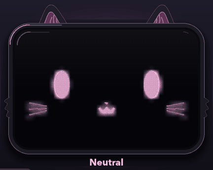
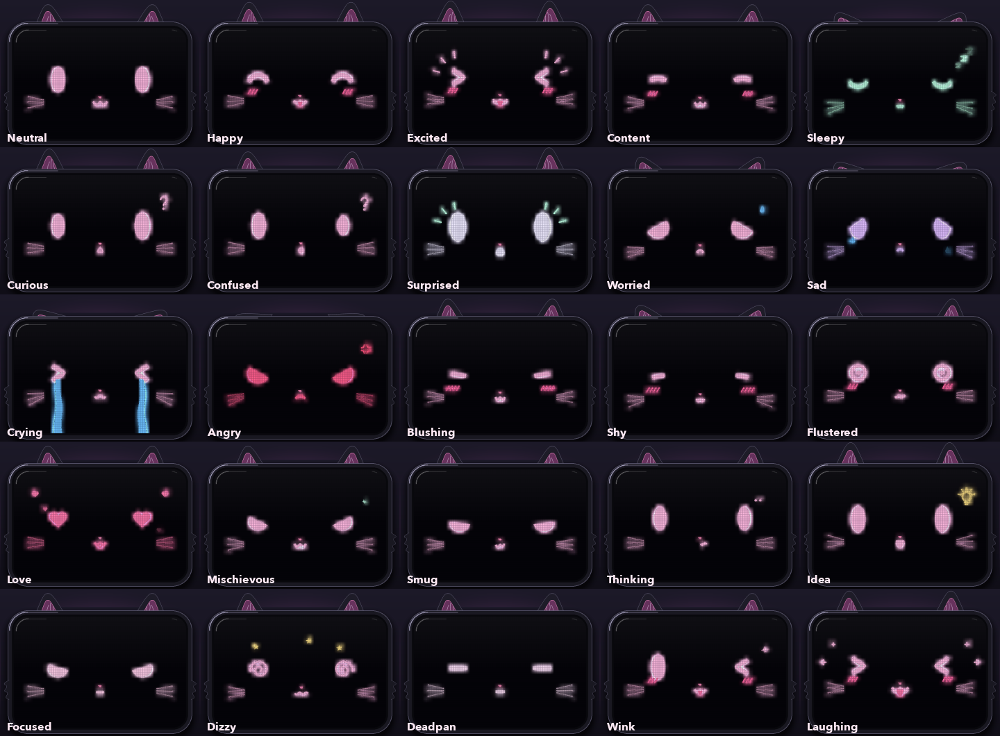

# Robo Face 🐱

A glowing, cat-eared robot face with **25 animated expressions**, written in Python with pygame.
Pick an expression with a button or a key and the face **morphs smoothly** into it: eyes, mouth, colours, ears and all.



## Features

- **25 expressions**: Neutral, Happy, Excited, Content, Sleepy, Curious, Confused, Surprised, Worried, Sad, Crying, Angry, Blushing, Shy, Flustered, Love, Mischievous, Smug, Thinking, Idea, Focused, Dizzy, Deadpan, Wink and Laughing.
- **Smooth morphing** between any two faces, with a springy overshoot and a little hop.
- **Blinking**: press <kbd>Space</kbd> to blink. Automatic blinking (with the occasional double blink) can be toggled with <kbd>A</kbd>.
- **Cat details**: ears that perk up, droop or flatten with the mood and twitch now and then, plus whiskers, a nose and `:3` mouths.
- **Animated extras per expression**: floating *Zzz*, falling tears, a pulsing anger mark, orbiting dizzy stars, a flickering light bulb, heart eyes that beat and more.
- **Neon LED look**: a bloom glow, a dot-matrix pixel grid and a glossy bezel.
- **No image files**: everything is drawn in code at 60 FPS (about 5 ms per frame).



## Quick start

Requires Python 3.8+.

```bash
git clone https://github.com/wreckVarun/robo-face.git
cd robo-face
python3 -m venv .venv
source .venv/bin/activate          # Windows: .venv\Scripts\activate
pip install -r requirements.txt
python robot_face.py
```

## Controls

| Input | Action |
| --- | --- |
| Click a button | Switch to that expression |
| <kbd>1</kbd>–<kbd>0</kbd> | Faces 1–10 |
| <kbd>Q</kbd>–<kbd>P</kbd> | Faces 11–20 |
| <kbd>Z</kbd> <kbd>X</kbd> <kbd>C</kbd> <kbd>V</kbd> <kbd>B</kbd> | Faces 21–25 |
| <kbd>←</kbd> / <kbd>→</kbd> | Previous / next expression |
| <kbd>Space</kbd> | Blink |
| <kbd>A</kbd> | Toggle automatic blinking |
| <kbd>Esc</kbd> | Quit |

The keys follow the button grid, one keyboard row per two rows of faces:

| | | | | |
| --- | --- | --- | --- | --- |
| `1` Neutral | `2` Happy | `3` Excited | `4` Content | `5` Sleepy |
| `6` Curious | `7` Confused | `8` Surprised | `9` Worried | `0` Sad |
| `Q` Crying | `W` Angry | `E` Blushing | `R` Shy | `T` Flustered |
| `Y` Love | `U` Mischievous | `I` Smug | `O` Thinking | `P` Idea |
| `Z` Focused | `X` Dizzy | `C` Deadpan | `V` Wink | `B` Laughing |

## How it works

**Shape morphing.** Every eye, mouth and tongue is a polygon with exactly **96 points**, always listed in the same order (top edge left to right, then the bottom edge back). Because all shapes share the same point count and order, any face can turn into any other by moving each point from its old position to its new one. The shapes are built from a few small builders:

- `ellipse` for round eyes.
- `clipped_ellipse` for eyes with a slanted eyelid (angry, sad, smug).
- `stroke`, which turns a centre line into a ribbon. Arcs, `> <` eyes, `ω` mouths and spirals are all made this way.
- `ring` and `heart_pts` for the flustered and love eyes.

**Easing.** Shape positions use an *ease-out-back* curve, so features slightly overshoot and settle. Colours use *smoothstep*. The whole face does a small hop while it changes.

**Blending moods.** Each expression can declare decorations, an idle motion (bounce, sway or tremble) and an ear pose. Every expression has a visibility weight that fades in and out, and those weights mix the decorations, motion and ear poses. That's why tears, stars and ear positions cross-fade instead of popping.

**Glow.** The features are drawn to an off-screen surface. That surface is shrunk and scaled back up (a cheap blur) and added onto the dark screen twice, once as a wide halo and once as a tight inner glow. The sharp shapes are drawn on top, and a dot-matrix grid is multiplied over everything to give the LED look.

## Customising

Each expression is one entry in the `EXPRESSIONS` list in [`robot_face.py`](robot_face.py):

```python
E("Mischievous",
  clipped_ellipse(34, 30, -2, 0.45),        # left eye (the right eye is mirrored)
  w_mouth(42, 10),                          # :3 mouth
  tongue=fang(9), tongue_col=WHITE,         # optional second shape under the mouth
  extras=[sparkle(MINT, EYE_X + 80, EYE_Y - 72)]),
```

Other options are `eye_r=` (a different right eye), `eye_col=` / `mouth_col=`, `motion=` (a function of time returning `(dx, dy, eye_scale)`) and `ears=(tilt, height)`.

## Project structure

```
robo-face/
├── robot_face.py          # the app: shapes, expressions, animation and rendering
├── tools/record_demo.py   # re-creates the images in assets/ (off-screen render)
├── assets/                # demo.gif, all_faces.png, screenshot.png
├── requirements.txt       # runtime: pygame
└── requirements-dev.txt   # extra for tools/: Pillow
```

To regenerate the images after changing faces:

```bash
pip install -r requirements-dev.txt
python tools/record_demo.py
```

## Ideas for next steps

- Run it on a Raspberry Pi with a small screen as a desk-robot face.
- Drive expressions from a webcam emotion model or from the tone of a chatbot's replies.
- Port it to the browser (Canvas/WebGL) so it can be tried without installing anything.
- Load expressions from a JSON file so new faces need no code changes.

## Credits

The visual style is inspired by a kawaii robot-face expression sheet. Every face here is drawn in code.

## License

[MIT](LICENSE)
